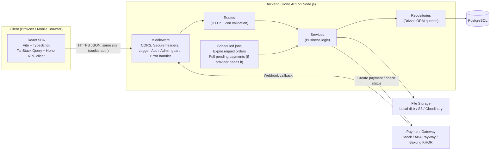

# System Architecture — ShopKH

## 1. Overview

ShopKH uses a **client–server architecture** with a clear separation between the React single-page application (frontend) and the Hono REST API (backend). The backend is the single source of truth for prices, stock, and order status. The frontend never calculates final prices or decides whether an order is paid.

Both apps live in one **monorepo** so the frontend can import the backend's route types for the Hono RPC client (type-safe API calls).

## 2. High-Level Architecture



## 3. Backend Layers

| Layer | Responsibility | Must NOT |
|---|---|---|
| **Routes** | Define HTTP endpoints, validate input with Zod (`@hono/zod-validator`), call a service, return JSON. | Contain business logic or database queries. |
| **Services** | Business rules: price calculation, stock reservation, status transitions, permission checks on ownership. Own transaction boundaries. | Know about HTTP (no `c.req`, no status codes). |
| **Repositories** | Database access with Drizzle. One repository per aggregate (products, orders…). | Contain business decisions or start their own transactions. |
| **Middleware** | Cross-cutting concerns: auth, role check, CORS, secure headers, logging, error mapping. | — |
| **lib** | Shared helpers: `AppError`, money formatting, payment provider interface, storage interface. | — |

**Why layers:** each layer can be understood, tested, and changed on its own. Business rules can be tested without starting an HTTP server, and changing the payment provider or file storage does not touch checkout code.

### 3.1 Transactions across layers

The **service** decides where a transaction starts and ends. It opens it with `db.transaction(...)` and passes the transaction handle `tx` to every repository method that must be part of it. Repository methods accept an optional `tx` and fall back to the normal `db` client:

```ts
// orders.service.ts
await db.transaction(async (tx) => {
  const cart = await cartRepo.lockByUserId(userId, tx);   // SELECT ... FOR UPDATE
  await productRepo.reserveStock(items, tx);              // atomic UPDATEs, sorted by id
  const order = await orderRepo.create(orderData, tx);
  await cartRepo.clear(cart.id, tx);
});

// products.repository.ts
reserveStock(items: StockItem[], tx: Db = db) { /* ... */ }
```

**Why:** the transaction must cover every step of a business operation (reserve stock, create order, clear cart), but only the service knows which steps belong together. Repositories stay simple query functions.

## 4. Key Design Decisions

### 4.1 Money as integer cents
All amounts are stored as integers in **cents** (USD). `$12.50` is stored as `1250`.
**Why:** floating-point numbers cause rounding errors (`0.1 + 0.2 = 0.30000000000000004`). Integers are exact.

### 4.2 Server-side price calculation
At checkout, the server reads current prices from the database and calculates subtotal, shipping, and total. Shipping is `SHIPPING_FEE_CENTS`, or `0` when the subtotal is at least `FREE_SHIPPING_THRESHOLD_CENTS`.
**Why:** a user can modify any request in the browser. Trusting the client price means anyone could buy at $0.01.

### 4.2a Order number
`SKH-YYYYMMDD-NNNNNN`: the date in Asia/Phnom_Penh time plus `nextval('order_number_seq')` padded to 6 digits (ERD §4.2). Generated inside the checkout transaction.
**Why:** a sequence never gives the same number twice, even for simultaneous checkouts, and needs no locking.

### 4.3 Stock reservation at order creation
Stock is reduced **when the order is created**, inside the same database transaction, using an atomic update:

```sql
UPDATE products
SET stock_quantity = stock_quantity - :qty
WHERE id = :productId AND is_active = true AND stock_quantity >= :qty;
-- 0 rows updated => out of stock (or inactive) => rollback the whole order
```

**Why:** if stock were reduced only after payment, two customers could both pay for the last item. The `WHERE stock_quantity >= :qty` condition makes the check and the update one atomic step, so stock can never go negative.

**Rules inside the checkout transaction:**
- **Lock the cart first** with `SELECT ... FROM carts WHERE user_id = :userId FOR UPDATE`, and clear the cart in the same transaction. A double-click on "Place order" then runs one request after the other; the second finds an empty cart and fails with `CART_EMPTY` instead of creating a second order.
- **Update products in a fixed order** (sorted by `product_id`). Two checkouts that touch the same products then always lock them in the same order and cannot deadlock each other.

**Trade-off:** unpaid orders hold stock. Solution: online-payment orders expire after `ORDER_PAYMENT_TIMEOUT_MINUTES` (15) if not paid; see §4.6.

### 4.4 Order item snapshot
`order_items` stores `product_name` and `unit_price_cents` copied at purchase time.
**Why:** if the admin later renames a product or changes its price, past orders and receipts must stay exactly as they were.

### 4.5 Safe status changes (concurrency)
Several actors can change the same order at the same moment: the payment webhook, the expiry job, the customer cancelling, and an admin. Every status change is therefore a **conditional update** that only succeeds if the order is still in the expected status:

```sql
UPDATE orders
SET status = :to, updated_at = now()
WHERE id = :orderId AND status = :expectedFrom;
-- 0 rows updated => someone else changed it first => stop, do not touch stock or payments
```

The stock restore, payment update, and `order_status_history` insert happen in the same transaction, **only if** this update changed 1 row.

**Example:** a payment arrives at the same second the expiry job runs. Both try `WHERE status = 'pending'`; PostgreSQL lets only one succeed. If expiry wins, the webhook sees 0 rows, records the payment as successful, and the order appears in the admin "needs manual refund" filter (flowchart 4).

### 4.6 Unpaid order expiry
A scheduled job runs every minute (flowchart 6). It handles **one order per transaction**: `SELECT ... LIMIT 1 FOR UPDATE SKIP LOCKED`, cancel it, commit, and repeat until no expired order is left. The row lock lasts until the commit, so if more than one API instance is running, each order is processed by only one of them.

**Why one transaction per order:** a lock taken by a separate `SELECT` is released as soon as that statement's transaction ends. Selecting all orders first and cancelling them later would leave them unlocked in between.

**Lazy expiry as a safety net:** on hosts that put the server to sleep (for example, free Render/Railway plans), the job may not run on time. So the services also treat `status = 'pending' AND expires_at < now()` as expired:
- `initiate payment` rejects it with `ORDER_EXPIRED`;
- reading the order cancels it first (same transaction as the job), then returns it.

### 4.7 Idempotent payment callbacks
Payment gateways may send the same callback more than once, sometimes at the same moment. The payment is marked successful with a conditional update:

```sql
UPDATE payments
SET status = 'success', paid_at = now(), raw_response = :raw
WHERE provider_txn_id = :txnId AND status <> 'success';
-- 0 rows updated => already processed => return 200, change nothing
```

A partial unique index `payments (order_id) WHERE status = 'success'` (see ERD) makes "at most one successful payment per order" a database rule, not just a code rule.

**If the index rejects a second success** (the customer managed to pay twice): roll back, log the raw callback, set `orders.needs_refund = true` in a new transaction, and return `200` so the gateway stops retrying. The admin refunds the extra payment from the gateway's merchant portal. To make this rare, `initiate` returns the existing pending payment instead of creating a new one (§6).

**Failed results** are also conditional: `UPDATE payments SET status = 'failed' WHERE provider_txn_id = ? AND status = 'pending'`, so a late "failed" can never overwrite a "success".
**Why:** a "look it up, then update" check is two steps; two identical callbacks arriving together could both pass it. A single conditional update cannot be passed twice.

### 4.8 Payment provider interface
```ts
interface PaymentProvider {
  createPayment(order: Order): Promise<{ paymentUrl?: string; qrString?: string; providerTxnId?: string }>;
  verifyCallback(request: Request): Promise<{ providerTxnId: string; status: 'success' | 'failed' }>;
  checkStatus?(providerTxnId: string): Promise<'pending' | 'success' | 'failed'>;
}
```
Implementations: `CodProvider` (no `providerTxnId`), `MockProvider` (development/demo), later `AbaPaywayProvider` or `BakongProvider`.

- Providers that send webhooks (ABA PayWay, Mock) implement `verifyCallback`.
- Providers that must be **polled** implement `checkStatus`; a scheduled job checks pending payments of non-expired orders every few seconds and processes a result exactly like a webhook (§4.7).
- **To verify before integration:** Bakong KHQR's Open API is, to our understanding, polling-based (check transaction by hash) rather than webhook-based. Confirm against the official Bakong documentation when the merchant account is approved.

**Why:** the order service doesn't care which gateway is used or how it reports results, so the real gateway can be added without rewriting checkout.

**Mock payments in production:** the `/payments/mock/...` route is registered only when `ENABLE_MOCK_PAYMENTS=true`. It is off by default and must stay off in any deployment that takes real payments.

### 4.9 Authentication
- Password hashing: argon2 (or bcrypt).
- On login **and on successful registration**, the API issues a signed JWT (7-day expiry) in an `httpOnly`, `secure`, `sameSite=lax` cookie. A new customer is logged in immediately.
- Login checks the password **first**, then `is_active`. Wrong email or wrong password both return the same `INVALID_CREDENTIALS`; `ACCOUNT_DISABLED` is returned only after a correct password, so nobody can probe which accounts exist or are disabled.
- Emails are stored and compared in lowercase.
- `authMiddleware` verifies the JWT, then **loads the user from the database** by id on every request and rejects the request with `ACCOUNT_DISABLED` if `is_active = false`. It sets `c.var.user` from the database row, not from the token. `requireAdmin` checks `c.var.user.role === 'admin'`.
- Logout clears the cookie. The JWT itself stays valid until it expires, but a deactivated account is blocked immediately by the database check.

**Why httpOnly cookie:** JavaScript cannot read it, which protects the token from XSS attacks (unlike localStorage).
**Why load the user every request:** deactivating a customer (FR-25) or changing a role must take effect immediately, not after up to 7 days. A primary-key lookup is cheap.
**Why the web and API must be on the same site:** see §8.

### 4.10 Error handling
Services throw `AppError(code, message)` — **no HTTP status**, because services do not know about HTTP. A global `app.onError` handler maps each code to a status using one table, and returns a consistent JSON shape:

```json
{ "error": { "code": "OUT_OF_STOCK", "message": "Product 'Blue T-shirt' has only 2 left." } }
```

| Code | HTTP | When |
|---|---|---|
| `VALIDATION_ERROR` | 400 | Zod validation failed (`details` field lists the issues) |
| `UNAUTHENTICATED` | 401 | No or invalid auth cookie |
| `INVALID_CREDENTIALS` | 401 | Wrong email or password |
| `ACCOUNT_DISABLED` | 403 | User `is_active = false` |
| `FORBIDDEN` | 403 | Not an admin, or not the owner |
| `NOT_FOUND` | 404 | Resource does not exist (also used for other users' resources, to avoid leaking that they exist) |
| `EMAIL_TAKEN` | 409 | Registration with an existing email |
| `OUT_OF_STOCK` | 409 | Not enough stock when adding to cart or checking out |
| `CART_EMPTY` | 409 | Checkout with an empty cart |
| `INVALID_STATUS_TRANSITION` | 409 | Status change not allowed (flowchart 5), or the order changed in the meantime |
| `ORDER_EXPIRED` | 409 | Paying for an order past `expires_at` |
| `ALREADY_REVIEWED` | 409 | Second review for the same product |
| `NOT_ELIGIBLE_TO_REVIEW` | 403 | No delivered order containing the product |
| `RATE_LIMITED` | 429 | Too many login/register attempts |
| `INTERNAL_ERROR` | 500 | Any unexpected error (details logged, not returned) |

## 5. Monorepo Folder Structure

```
shopkh/
├── CLAUDE.md
├── docs/                         # proposal, architecture, ERD, flowcharts, plan
├── docker-compose.yml            # PostgreSQL for development
├── package.json                  # pnpm workspaces root
├── pnpm-workspace.yaml
└── apps/
    ├── api/
    │   ├── drizzle.config.ts
    │   ├── src/
    │   │   ├── index.ts           # Node server entry; starts scheduled jobs
    │   │   ├── app.ts             # Hono app; mounts routes; exports `AppType`
    │   │   ├── config/env.ts      # env vars validated with Zod
    │   │   ├── db/
    │   │   │   ├── schema.ts      # Drizzle tables (matches docs/04-erd.md)
    │   │   │   ├── client.ts
    │   │   │   ├── migrations/
    │   │   │   └── seed.ts
    │   │   ├── middleware/        # auth.ts, require-admin.ts, error-handler.ts, rate-limit.ts
    │   │   ├── modules/
    │   │   │   ├── auth/          # auth.routes.ts, auth.service.ts, auth.schemas.ts
    │   │   │   ├── users/
    │   │   │   ├── addresses/
    │   │   │   ├── categories/
    │   │   │   ├── products/      # *.routes.ts, *.service.ts, *.repository.ts, *.schemas.ts
    │   │   │   ├── cart/
    │   │   │   ├── orders/
    │   │   │   ├── payments/
    │   │   │   ├── reviews/
    │   │   │   └── admin/         # admin routes (reports, customers, order status)
    │   │   ├── lib/               # errors.ts, money.ts, storage/, payment/
    │   │   └── jobs/              # expire-orders.ts, poll-payments.ts
    │   └── tests/
    └── web/
        └── src/
            ├── main.tsx
            ├── router.tsx
            ├── lib/api-client.ts  # hc<AppType>(...)
            ├── components/        # shared UI (shadcn/ui)
            ├── layouts/           # ShopLayout, AdminLayout
            ├── features/          # auth, catalog, cart, checkout, orders, admin
            └── pages/
```

### 5.1 Type-safe RPC setup
- `app.ts` must **chain** route registrations so the full type is kept: `const routes = app.route('/auth', auth).route('/products', products)...; export type AppType = typeof routes`. Registering routes in separate statements loses the types.
- `apps/web` lists `api` as a workspace dependency (`"api": "workspace:*"`) and imports **types only**: `import type { AppType } from 'api/src/app'`. No backend code is bundled into the web app.

## 6. API Endpoints

All endpoints are prefixed with `/api`. 🔒 = login required, 👑 = admin only.

**Conventions**
- List endpoints accept `page` (default 1) and `pageSize` (default 20, max 100) and return `{ items, page, pageSize, total }`.
- Errors use the format in §4.10.
- Customer endpoints always use `user_id` from the auth cookie. Requests for another user's resource return `NOT_FOUND`.

### Auth
| Method | Path | Description |
|---|---|---|
| POST | `/auth/register` | Register customer, sets cookie (logged in immediately; rate-limited) |
| POST | `/auth/login` | Login, sets cookie (rate-limited) |
| POST | `/auth/logout` | Clears cookie |
| GET | `/auth/me` 🔒 | Current user |

### Profile & Addresses 🔒
| Method | Path | Description |
|---|---|---|
| PATCH | `/me` | Update profile |
| GET / POST | `/addresses` | List / create address |
| PATCH / DELETE | `/addresses/:id` | Update / delete address. Deleting the default address leaves the customer with no default until they choose one. |
| POST | `/addresses/:id/default` | Set default (clears the old default in the same transaction) |

### Catalog (public)
| Method | Path | Description |
|---|---|---|
| GET | `/categories` | Active category tree (max 2 levels) |
| GET | `/products` | Visible products (product active **and** its category, and that category's parent, active — ERD §4.1), with `search`, `category` (a parent category includes its sub-categories), `minPrice`, `maxPrice`, `sort`, `page`, `pageSize` |
| GET | `/products/:slug` | Product detail with images and rating summary |
| GET | `/products/:slug/reviews` | Product reviews (paginated) |

### Reviews 🔒
| Method | Path | Description |
|---|---|---|
| POST | `/products/:slug/reviews` | Create review (product must be active; must have a delivered order containing it; one per product). Recalculates `avg_rating` / `review_count` from the reviews table in the same transaction. |

### Cart 🔒
| Method | Path | Description |
|---|---|---|
| GET | `/cart` | Cart with items and current prices. Each item has an `issue` field: `null`, `inactive` (product deactivated), or `insufficient_stock` (with `availableQuantity`). Items are not removed automatically; checkout fails until the customer fixes them. |
| POST | `/cart/items` | Add item `{ productId, quantity }` |
| PATCH | `/cart/items/:itemId` | Change quantity |
| DELETE | `/cart/items/:itemId` | Remove item |

### Orders & Payments 🔒
| Method | Path | Description |
|---|---|---|
| POST | `/orders` | Checkout `{ addressId, paymentMethod, note? }` (flowchart 3). `addressId` must belong to the caller (`NOT_FOUND` otherwise). Creates a COD payment row at once; online payment rows are created at initiate. |
| GET | `/orders` | My orders |
| GET | `/orders/:orderNumber` | Order detail + status history + latest payment status. The payment page polls this every 3 seconds (flowchart 11). |
| POST | `/orders/:orderNumber/cancel` | Cancel (only `pending` / `confirmed`, flowchart 10). If the order was paid online, sets `needs_refund = true`. |
| POST | `/payments/:orderNumber/initiate` | Start online payment, returns payment URL or QR. Allowed only if the order belongs to the caller, `payment_method = online`, `status = pending`, and `expires_at > now()`. If the order already has a `pending` payment, returns **that same** `payment_url` / `qr_string` stored on the row (no new row). Creates a new payment row only if there is none yet or the last one `failed` / `expired`. If two clicks race, the partial unique index on pending payments rejects the second insert; the service then reads and returns the existing pending payment. |
| POST | `/payments/webhook/:provider` | Gateway callback — see below |
| POST | `/payments/mock/:paymentId/complete` | Simulate success or failure. Registered only when `ENABLE_MOCK_PAYMENTS=true`. |

**Webhook route rules**
- Mounted **outside** the auth and CORS middleware (the caller is the gateway, not the browser).
- Invalid signature → `401`, log a warning.
- Unknown `provider_txn_id` → `200`, log an error. (Returning an error would make the gateway retry forever for a payment we cannot match.)
- Otherwise processed as in §4.7 and flowchart 4; always `200` once handled.

### Admin 👑
| Method | Path | Description |
|---|---|---|
| GET / POST | `/admin/products` | List (incl. inactive) / create |
| PATCH | `/admin/products/:id` | Update (incl. activate/deactivate) |
| POST | `/admin/products/:id/stock-adjustments` | Adjust stock by a change amount `{ delta, reason }` (e.g. `+20` restock, `-1` damaged). V1 writes `reason` to the application log; it is not stored in the database. |
| POST | `/admin/products/:id/images` | Upload image |
| PATCH | `/admin/products/:id/images/:imageId` | Change `sortOrder`, `altText`, or set `isPrimary` (clears the old primary in the same transaction) |
| DELETE | `/admin/products/:id/images/:imageId` | Delete image (if it was primary, the next image by `sort_order` becomes primary) |
| GET / POST | `/admin/categories` | List (incl. inactive) / create |
| PATCH | `/admin/categories/:id` | Update (incl. activate/deactivate, `sortOrder`, `parentId`). Rejects a parent that itself has a parent (max 2 levels), or making a category with children into a sub-category. Deactivating hides its products from the shop. |
| GET | `/admin/orders` | List with filters (status, date, search, `needsRefund` = `orders.needs_refund = true`) |
| GET | `/admin/orders/:orderNumber` | Detail |
| PATCH | `/admin/orders/:orderNumber/status` | Change status (validated transitions, flowchart 9) |
| POST | `/admin/orders/:orderNumber/refund-handled` | Admin confirms the manual refund was done: `needs_refund = false`, sets `refund_handled_at` / `refund_handled_by` |
| GET | `/admin/customers` | Customer list |
| PATCH | `/admin/customers/:id` | Activate / deactivate |
| GET | `/admin/reports/summary` | Revenue (definition in ERD §4.3: paid and not cancelled), order counts, top products, low stock. Query: `from`, `to` (dates, inclusive), interpreted in Asia/Phnom_Penh (UTC+7). Default: last 30 days. |

**Why stock adjustments use a change amount:** setting an absolute number (`stock = 50`) can silently undo a checkout that reserved stock a moment earlier. A change amount is applied atomically, `stock_quantity = stock_quantity + :delta WHERE stock_quantity + :delta >= 0`, so it never conflicts with checkouts and never goes negative.

## 7. Security Checklist

- Validate every request body, query, and param with Zod.
- Check **ownership**: a customer may only read/modify their own cart, addresses, and orders (always filter by `user_id` from the token, never from the request).
- Admin routes protected by `requireAdmin`; `authMiddleware` re-checks `is_active` on every request.
- Rate-limit `/auth/login` and `/auth/register` per IP. **Note:** an in-memory rate limiter only works with a single API instance; with several instances, store counters in PostgreSQL or Redis.
- Secure response headers with `hono/secure-headers`.
- CORS allows only the web app origin, with `credentials: true` (not applied to the webhook route).
- Verify payment webhook signatures.
- Uploaded files: allow only image MIME types, limit size (e.g. 5 MB), generate random file names.
- Mock payment route disabled unless `ENABLE_MOCK_PAYMENTS=true`.
- Never return `password_hash` in any response.

## 8. Environments and Deployment

**Same-site rule:** the browser must see the web app and the API as the **same site**, otherwise the `sameSite=lax` auth cookie is not sent with API requests and every logged-in call fails. For example, `shopkh.vercel.app` and `shopkh-api.onrender.com` are different sites. Use one of these:

1. **Proxy (recommended):** the web host forwards `/api/*` to the API, so the browser only ever talks to one origin. CORS is then not needed in production.
2. **Sibling subdomains on your own domain:** `shop.example.com` (web) and `api.example.com` (API). Set `COOKIE_DOMAIN=example.com` only if needed; keep CORS limited to `WEB_ORIGIN`.

| Environment | Web | API | Database | How same-site is achieved |
|---|---|---|---|---|
| Local | Vite dev server `:5173` | Node 22 `:3000` | Docker PostgreSQL 16 on host port `5434` (5432/5433 are often taken by native PostgreSQL installs) | Vite `server.proxy` forwards `/api` to `:3000` |
| Production (simple) | Vercel / Cloudflare Pages / Netlify | Render / Railway / Fly.io | Neon / Supabase / Railway PostgreSQL | Host rewrite `/api/*` → API URL (e.g. Vercel `rewrites`), or custom subdomains |
| Production (AWS) | S3 + CloudFront | ECS Fargate (Docker) behind an ALB | RDS PostgreSQL | CloudFront behavior `/api/*` → ALB origin |

**Scheduled jobs on sleeping hosts:** free tiers that put the API to sleep stop the jobs too. Lazy expiry (§4.6) keeps behavior correct; for real use, choose an always-on plan or trigger the job from an external scheduler.

Environment variables (API):

| Variable | Purpose |
|---|---|
| `NODE_ENV` | `development` / `test` / `production` |
| `PORT` | API port (default 3000) |
| `DATABASE_URL` | PostgreSQL connection string |
| `JWT_SECRET` | Signs auth tokens |
| `WEB_ORIGIN` | Allowed CORS origin |
| `COOKIE_DOMAIN` | Optional; only for the sibling-subdomain setup |
| `SHIPPING_FEE_CENTS` | Flat shipping fee |
| `FREE_SHIPPING_THRESHOLD_CENTS` | Subtotal at which shipping is free |
| `ORDER_PAYMENT_TIMEOUT_MINUTES` | Unpaid online order lifetime (default 15) |
| `ENABLE_MOCK_PAYMENTS` | `true` registers the mock payment route (default `false`) |
| `STORAGE_DRIVER` | `local` / `s3` / `cloudinary` |
| `TRUST_PROXY` | `true` only behind a reverse proxy that sets `X-Forwarded-For`; the rate limiter then uses that header for the client IP (default `false`) |
| `STORAGE_*` | Driver credentials, e.g. `S3_BUCKET`, `S3_REGION`, `AWS_ACCESS_KEY_ID`, `AWS_SECRET_ACCESS_KEY`, or `CLOUDINARY_URL` |
| Payment gateway keys | e.g. `ABA_PAYWAY_MERCHANT_ID`, `ABA_PAYWAY_API_KEY`, `BAKONG_TOKEN` |
| `ADMIN_EMAIL`, `ADMIN_PASSWORD` | Used **only** by `db:create-admin` to create the production admin; set them for that run, then remove them |

**Database scripts in production:** run `db:migrate` on every deploy. Never run `db:seed`: it creates demo accounts with known passwords and refuses to run when `NODE_ENV=production`. Create the real admin with `db:create-admin`.
