# System Flowcharts — ShopKH

Diagrams use Mermaid. They render on GitHub, in VS Code (Markdown Preview Mermaid Support extension), and at https://mermaid.live.

**Notation:** `[[double box]]` = a server step that runs inside a database transaction. Error codes (e.g. `OUT_OF_STOCK`) are listed in architecture §4.10.

| # | Flowchart |
|---|---|
| 1 | Register and Login |
| 2 | Browse and Add to Cart |
| 3 | Checkout and Order Creation |
| 4 | Online Payment |
| 5 | Order Status Lifecycle |
| 6 | Unpaid Order Expiry Job |
| 7 | Admin: Manage Product |
| 8 | Write a Review |
| 9 | Admin: Process Order |
| 10 | Customer: Cancel Order |
| 11 | Payment Page: Wait for Result |

---

## 1. Register and Login

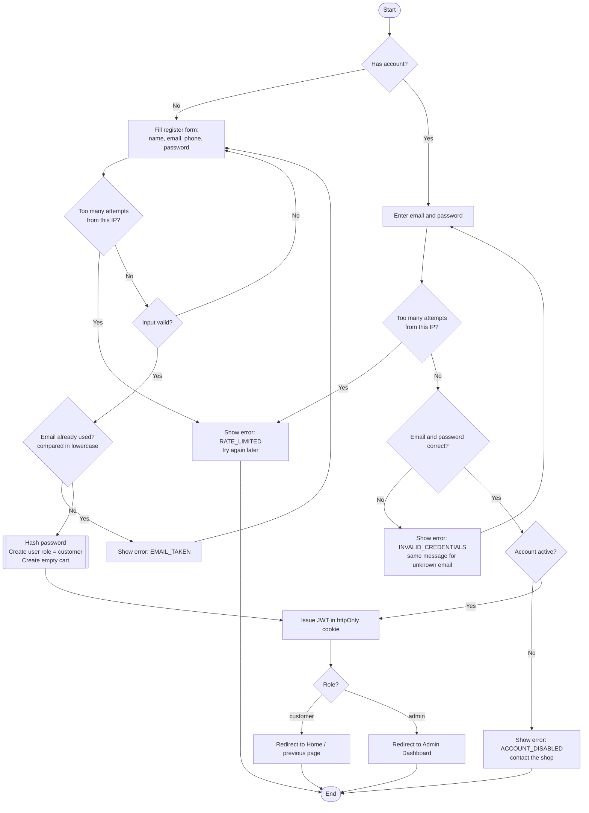

- Registering **logs the customer in immediately** (G → K); they do not type their password again.
- The password is checked **before** the active flag. Someone who does not know the password therefore cannot find out whether an account exists or is disabled.
- Emails are lowercased before saving; the unique constraint on `email` backs up check E if two registrations with the same email arrive at the same moment.

## 2. Browse and Add to Cart

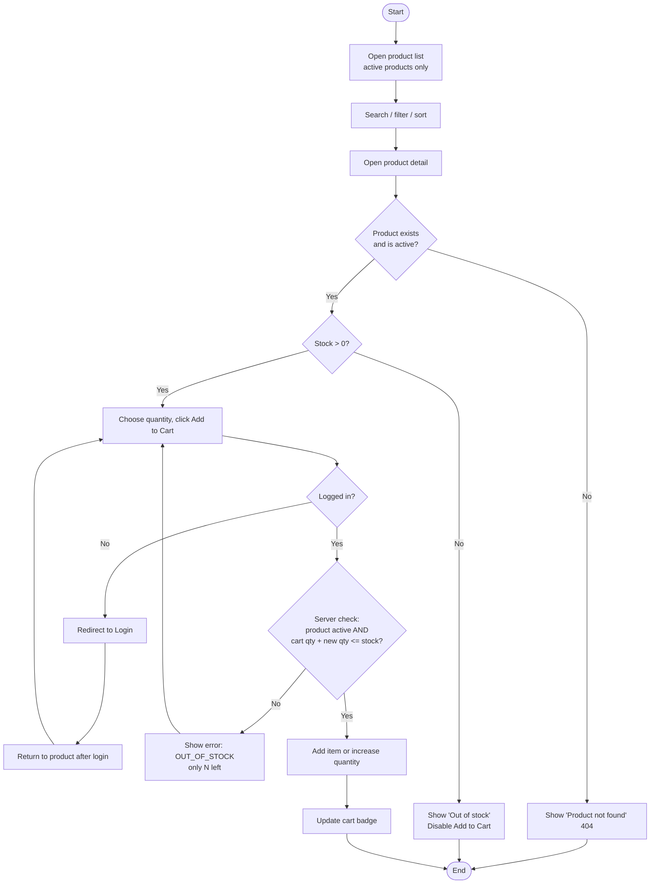

- The browser may disable the button early, but check K always runs on the **server**; the browser's stock number can be out of date.
- Changing quantity in the cart (`PATCH /cart/items/:itemId`) runs the same check K.

## 3. Checkout and Order Creation

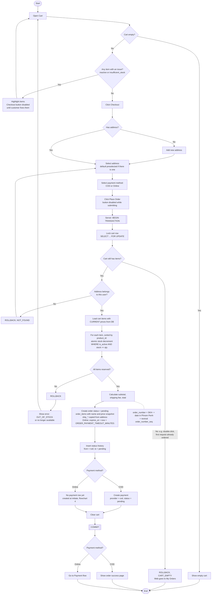

## 4. Online Payment

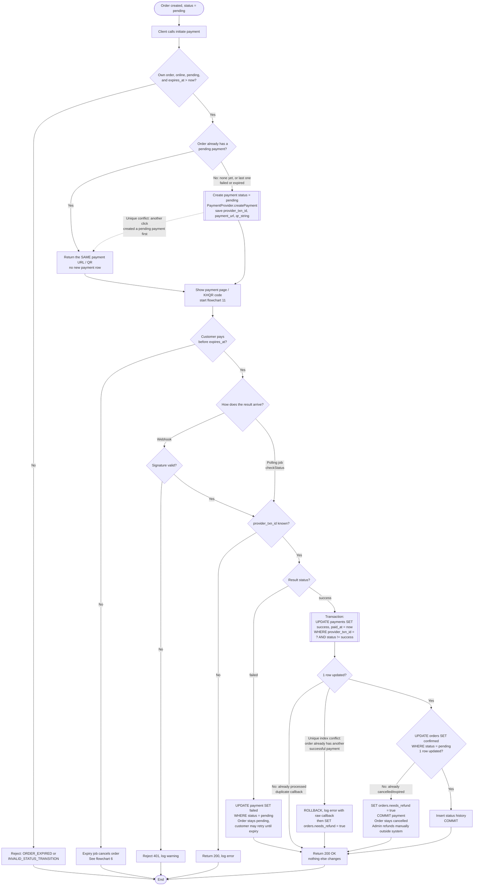

**Why conditional updates:** the webhook, a duplicate webhook, and the expiry job can run at the same moment. Each step only changes a row if it is still in the expected status, so PostgreSQL decides who wins and nothing is processed twice (architecture §4.5, §4.7).

**Why reuse the pending payment:** if every click on "Pay" created a new QR code, a customer could scan and pay two of them. Returning the same QR while it is still pending prevents this in almost all cases. If it still happens (for example, the customer pays a QR from a failed attempt that the gateway accepted late), the second success conflicts with the "one success per order" index; the server logs it with the raw callback, sets `orders.needs_refund = true`, returns 200 so the gateway stops retrying, and the admin refunds the extra payment from the gateway's merchant portal.

## 5. Order Status Lifecycle

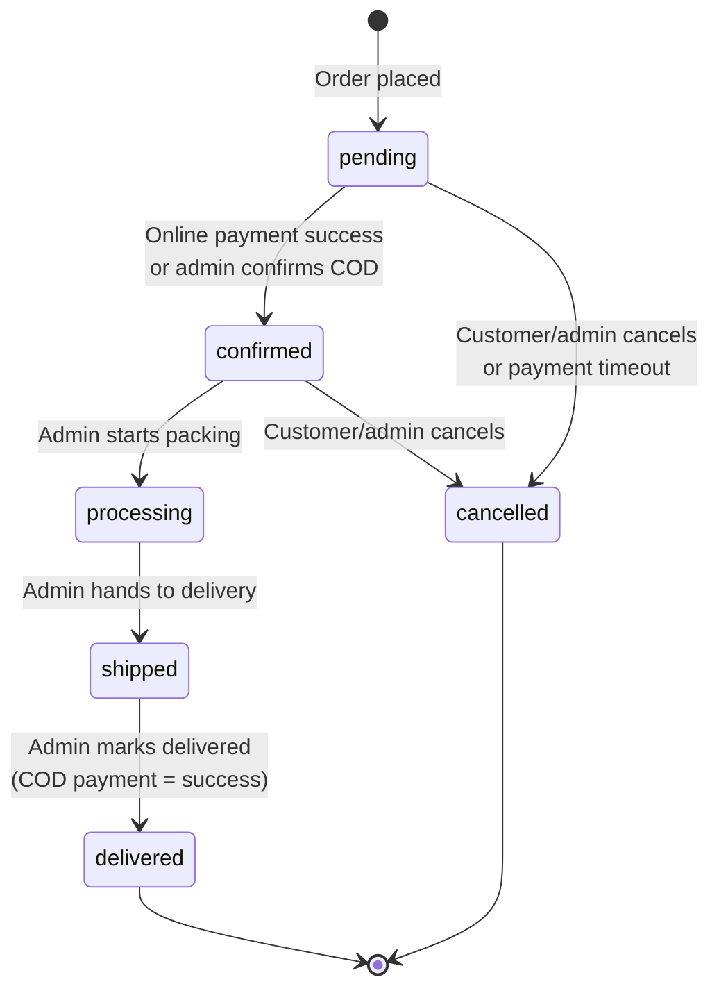

**Rules**
- Any transition not shown above is rejected by the server (`INVALID_STATUS_TRANSITION`).
- Every move to `cancelled` restores product stock (in the same transaction) and sets `cancel_reason`: `payment_timeout`, `customer_cancelled`, or `admin_cancelled`.
- Customers can cancel only from `pending` or `confirmed`. From `processing` onward, only admins can change the status, and only forward.
- Every change, including order creation (`null` → `pending`), inserts a row in `order_status_history`.
- For COD orders, the payment becomes `success` when the order becomes `delivered`.
- No transitions exist after `processing` other than `shipped` → `delivered`. Returns and failed deliveries are out of scope in V1 and handled manually by the shop.
- Refunds are out of scope: when a paid online order is cancelled, the admin refunds the customer outside the system. Every cancel of an order with a successful payment sets `orders.needs_refund = true`; admins find these orders with the `needsRefund` filter and click **Mark refund handled** after refunding. This sets `needs_refund = false` and records `refund_handled_at` and `refund_handled_by`.

## 6. Unpaid Order Expiry Job (runs every minute)

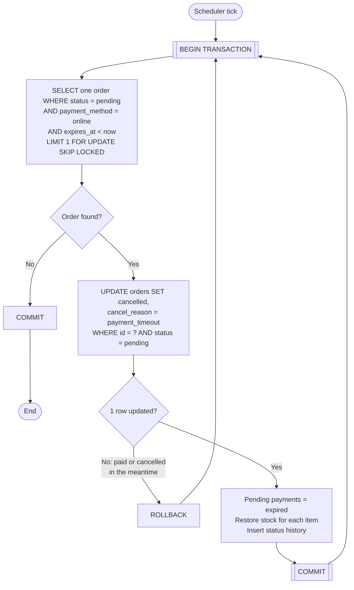

- **One transaction per order:** the row lock from `FOR UPDATE` lasts until COMMIT, so the order stays locked while it is being cancelled. `SKIP LOCKED` makes other API instances skip it and take the next order instead.
- The loop ends when no expired order is left.
- The same cancel logic runs **lazily** when an expired pending order is read or a payment is initiated, in case the job did not run on time (architecture §4.6).

## 7. Admin: Manage Product

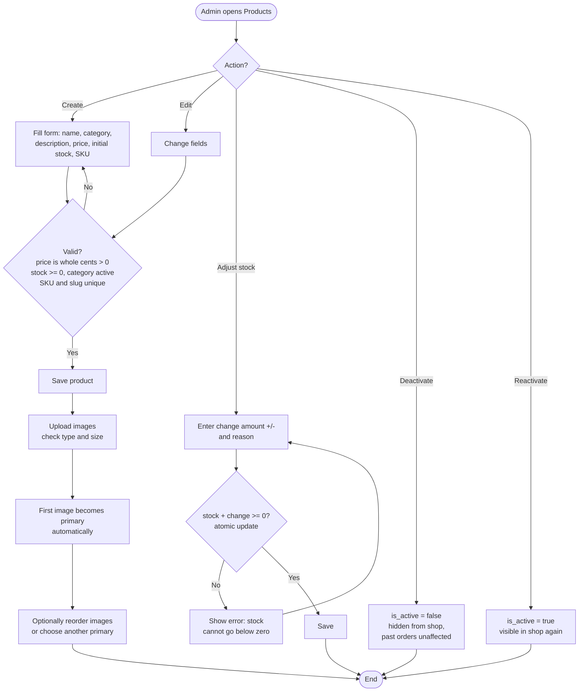

**Why deactivate instead of delete:** products are referenced by past orders and reviews. Deleting them would break order history.
**Why a change amount for stock:** see architecture §6 (Admin endpoints).

## 8. Write a Review

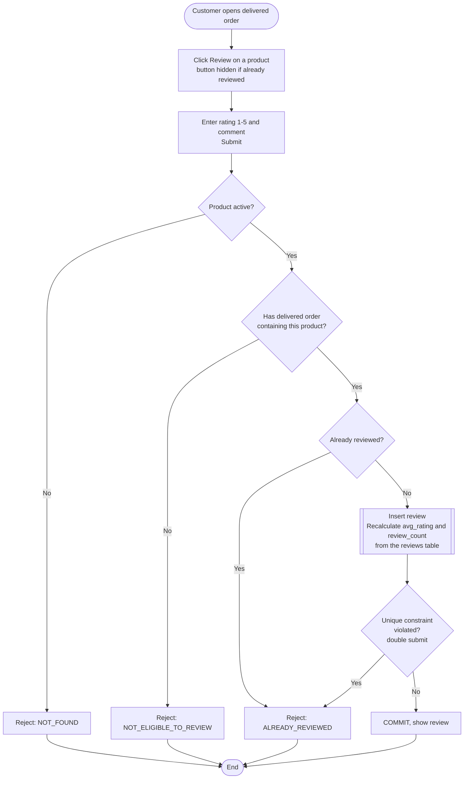

- The server checks C and E on submit even though the UI hides the button; the API can be called directly.
- **Recalculate, don't add:** `avg_rating` and `review_count` are computed from the `reviews` table (`AVG`, `COUNT`) in the same transaction. Updating them from a previously read value can be wrong if two reviews are saved at the same moment.
- Deactivated products cannot be reviewed, even from an old delivered order.

## 9. Admin: Process Order

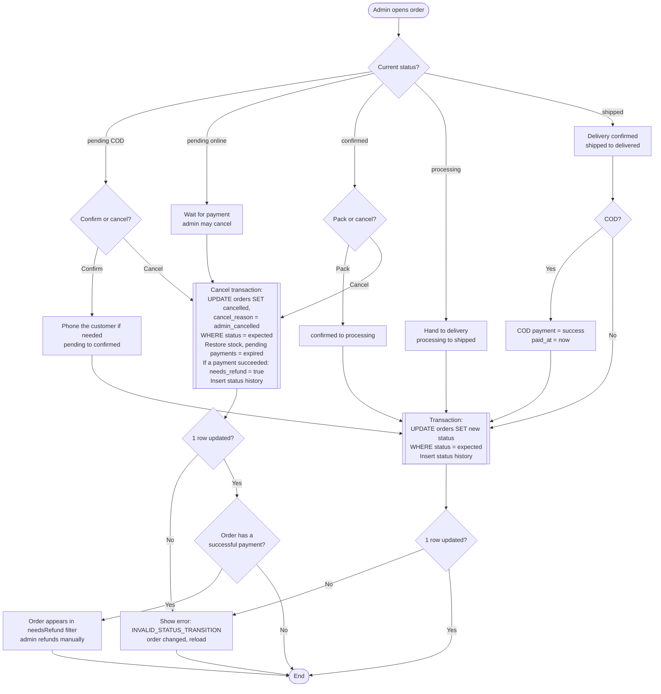

- The admin UI shows only the buttons for transitions allowed from the current status (flowchart 5). The server still validates every request.
- `delivered` and the COD payment update happen in the **same transaction**.

## 10. Customer: Cancel Order

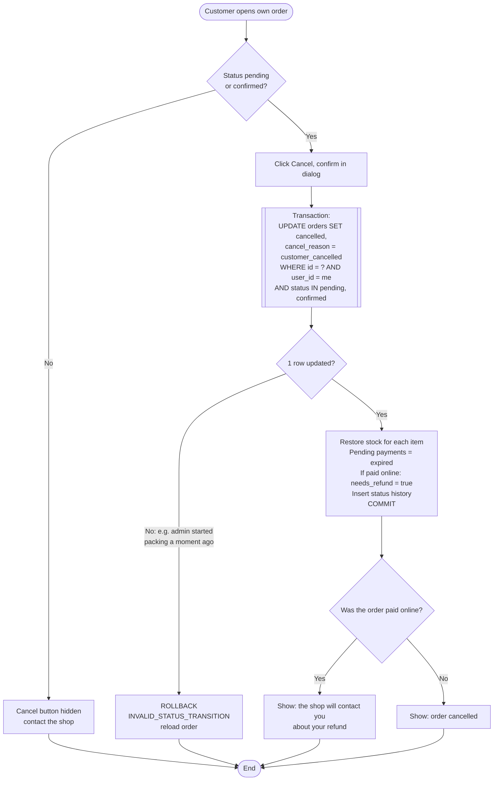

## 11. Payment Page: Wait for Result

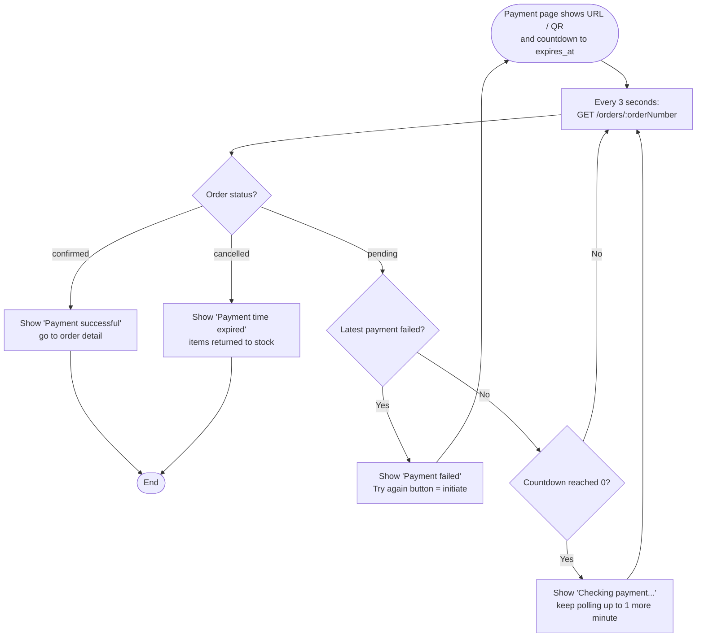

- The payment result goes from the gateway **to the server**, not to the browser, so the page asks the server until the order is decided.
- Polling stops when the customer leaves the page. When they come back to the order detail page, it shows the current status. Lazy expiry (flowchart 6) makes sure an expired order shows as cancelled.
- Polling continues for a short time after the countdown reaches 0, because a payment made just before the deadline may still be on its way.
