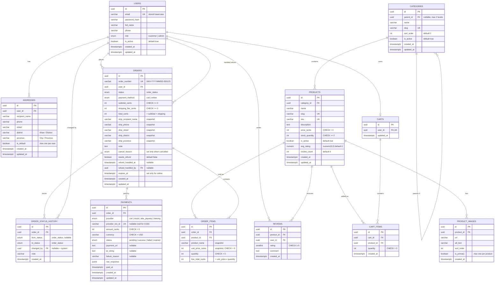

# Entity Relationship Diagram — ShopKH

## 1. Diagram

All columns are `NOT NULL` unless marked nullable. All timestamps are `timestamptz` (stored in UTC; reports convert to Asia/Phnom_Penh).

## 2. Enums

| Enum | Values |
|---|---|
| `user_role` | `customer`, `admin` |
| `order_status` | `pending`, `confirmed`, `processing`, `shipped`, `delivered`, `cancelled` — used by `orders.status`, `order_status_history.from_status` and `to_status` |
| `payment_method` | `cod`, `online` |
| `payment_provider` | `cod`, `mock`, `aba_payway`, `bakong` |
| `payment_status` | `pending`, `success`, `failed`, `expired` |
| `cancel_reason` | `payment_timeout`, `customer_cancelled`, `admin_cancelled` |

## 3. Relationships Explained

| Relationship | Cardinality | Business meaning |
|---|---|---|
| User – Address | 1 : N | A customer can save many delivery addresses; at most one is default. |
| User – Cart | 1 : 0..1 | Every customer gets one cart at registration. Admins have no cart. |
| Cart – Cart item | 1 : N | Unique on `(cart_id, product_id)`: adding the same product again increases quantity. |
| Category – Category | 1 : N | Optional parent for sub-categories (e.g. Clothing → T-shirts). Maximum 2 levels: a sub-category cannot have children. |
| Category – Product | 1 : N | Each product belongs to exactly one category (a parent or a sub-category). |
| Product – Image | 1 : N | At most one `is_primary = true` image per product (database rule); the first uploaded image becomes primary (service rule). |
| User – Order (places) | 1 : N | A customer can place many orders. |
| User – Order (handled refund) | 1 : N | The admin who marked a manual refund as handled (`refund_handled_by`). |
| Order – Order item | 1 : 1..N | An order has at least one item. |
| Order – Payment | 1 : N | COD: one row created at checkout. Online: one row per payment attempt, created at initiate; a new attempt is allowed only after the previous one `failed` or `expired`. At most one `pending` and at most one `success` per order, both enforced by partial unique indexes. |
| Order – Status history | 1 : N | Audit trail of every status change, including creation (`from_status = null`). |
| User – Status history (changed by) | 1 : N | Who made the change; `null` means the system (expiry job, payment callback). |
| Product/User – Review | N : M via `reviews` | Unique on `(product_id, user_id)`: one review per product per customer. |

## 4. Business Rules Stored in the Schema

### 4.1 Category visibility and filtering
- A product is shown in the shop only if **the product and its category are both active**. If its category is a sub-category, the parent must also be active.
- Filtering by a parent category **includes products of its sub-categories**.
- Deactivating a category hides its products from the shop but does not change `products.is_active`; reactivating the category shows them again.

### 4.2 Order number
Format `SKH-YYYYMMDD-NNNNNN`, for example `SKH-20261002-000123`:
- `YYYYMMDD` is the order date in **Asia/Phnom_Penh** time.
- `NNNNNN` comes from a PostgreSQL sequence `order_number_seq` (`nextval`), padded to 6 digits. The sequence never resets.

**Why a sequence:** two checkouts at the same moment always get different numbers, with no locking. A counter that resets each day would need its own table and row lock; the only cost of the sequence is that the number does not restart at 1 each day.

### 4.3 Revenue definition (reports)
**Revenue** = sum of `orders.total_cents` for orders that have a payment with `status = 'success'` **and** `orders.status <> 'cancelled'`. The day of an order is `orders.created_at` in Asia/Phnom_Penh.

This counts online orders once paid and COD orders once delivered (when their payment becomes `success`). Cancelled orders are excluded even if paid, because that money is refunded.

## 5. Important Constraints and Why

| Constraint | Why |
|---|---|
| `products.stock_quantity CHECK (stock_quantity >= 0)` | Last line of defense against overselling, even if code has a bug. |
| All money columns are `int` cents | Exact arithmetic, no floating-point rounding. |
| `CHECK` on money and quantity: `products.price_cents > 0`, `order_items.unit_price_cents > 0`, `order_items.quantity > 0`, `payments.amount_cents > 0`, `orders.subtotal_cents >= 0`, `orders.shipping_fee_cents >= 0` | No free, negative, or zero-quantity lines can be saved by mistake. |
| `CHECK (order_items.line_total_cents = unit_price_cents * quantity)` | Line totals can never disagree with their price and quantity. |
| `CHECK (orders.total_cents = subtotal_cents + shipping_fee_cents)` | The order total can never disagree with its parts. |
| `CHECK ((payment_method = 'online') = (expires_at IS NOT NULL))` | Only online orders expire; every online order has a deadline. |
| `CHECK ((status = 'cancelled') = (cancel_reason IS NOT NULL))` | Every cancelled order has a reason, and no other order has one. |
| `CHECK (NOT (needs_refund AND refund_handled_at IS NOT NULL))` | An order cannot be "needs refund" and "refund handled" at the same time. |
| `CHECK (payments.currency = 'USD')` | V1 is USD only; a different currency means a bug. |
| `order_items.product_name`, `unit_price_cents` snapshot | Past orders do not change when products are edited. |
| `orders.ship_*` snapshot (separate street, district, province; not FK to address) | If the customer edits or deletes an address, the order still shows where it was shipped. Separate fields allow filtering and reporting by province. |
| `orders.needs_refund` set in the same transaction as the cancel (or by the payment callback) | Refunds are done outside the system (out of scope), but the admin must never miss a paid order that was cancelled. |
| `UNIQUE (users.email)`, email stored lowercase | `Alice@x.com` and `alice@x.com` are the same account; also stops two simultaneous registrations with the same email. The service lowercases before every insert and lookup. |
| `payments.provider_txn_id UNIQUE` | Supports idempotent webhook handling. |
| `UNIQUE (order_id) WHERE status = 'success'` on payments (partial unique index) | An order can never have two successful payments, even if two callbacks are processed at the same moment. |
| `UNIQUE (order_id) WHERE status = 'pending'` on payments (partial unique index) | Two "Pay" clicks at the same moment cannot create two pending payments (two QR codes). The second insert fails; the service then returns the existing pending payment. |
| `UNIQUE (product_id) WHERE is_primary` on product images (partial unique index) | At most one primary image per product. "Set primary" clears the old one and sets the new one in one transaction. |
| `UNIQUE (user_id) WHERE is_default` on addresses (partial unique index) | At most one default address per customer. "Set default" clears the old one and sets the new one in one transaction. |
| `CHECK (categories.parent_id <> id)` | A category cannot be its own parent. The service also rejects a parent that itself has a parent (max 2 levels). |
| `UNIQUE (cart_id, product_id)` | No duplicate rows for the same product in one cart. |
| `UNIQUE (product_id, user_id)` on reviews | One review per product per customer. |
| Products use `is_active` instead of delete | Orders and reviews reference products; deleting would break history. |
| `ON DELETE CASCADE` only for owned children (`addresses`, `cart_items`, `product_images`) | These rows have no meaning without their parent. |
| `ON DELETE RESTRICT` (explicit) for `order_items.product_id`, `order_items.order_id`, `payments.order_id`, `reviews.product_id`, `reviews.user_id`, `orders.user_id`, `order_status_history.order_id` | Orders, order items, payments, and reviews must never be deleted by cascade; trying to delete a referenced row fails loudly. |

## 6. Indexes

PostgreSQL does **not** create indexes for foreign keys automatically, so the ones used in lookups are listed here. Unique constraints above already create their own indexes.

| Index | Used by |
|---|---|
| `addresses (user_id)` | My addresses |
| `products (category_id, is_active)` | Product list by category |
| `products (lower(name))` or a trigram index | Product search |
| `product_images (product_id, sort_order)` | Product images in display order |
| `orders (user_id, created_at DESC)` | My orders |
| `orders (status, created_at DESC)` | Admin order list filtered by status |
| `orders (created_at)` | Reports by date range |
| `orders (expires_at) WHERE status = 'pending' AND payment_method = 'online'` | Expiry job and lazy expiry |
| `orders (created_at) WHERE needs_refund = true` | Admin `needsRefund` filter |
| `order_items (order_id)`, `order_items (product_id)` | Order detail, top products report |
| `payments (order_id)` | Payments of an order (the partial unique indexes only cover some rows) |
| `payments (created_at) WHERE status = 'pending'` | Payment polling job (providers without webhooks) |
| `order_status_history (order_id, created_at)` | Order status timeline |
| `reviews (product_id, created_at DESC)` | Product reviews list |
